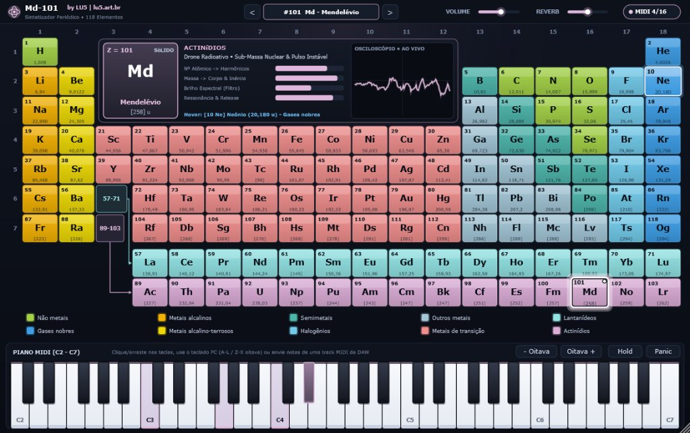

# Md-101 — Periodic Table Polyphonic VST3 Synthesizer

🌐 **Language / Idioma:** **English** | [Português (README.md)](README.md)

**Md-101** is a 16-voice polyphonic virtual MIDI instrument developed by **LU5** ([lu5.art.br](https://lu5.art.br)) in **C++17 / JUCE 8**, compatible with **Windows** and **Linux** in **VST3** (for any MIDI-capable DAW) and **Standalone** (independent desktop application) formats.

Each of the **118 chemical elements** of the Periodic Table acts as a unique synthesizer preset whose timbre is physically computed in real time from its **chemical family**, **atomic number ($Z$)**, **atomic mass ($A$)**, and **physical state (phase)**.



---

## Project Documentation

- 📘 **[User Manual (Markdown)](docs/MANUAL-en.md)** ([Versão em Português](docs/MANUAL.md)): Step-by-step installation guide, computer keyboard and mouse performance controls, DAW setup guide (Reaper, Waveform, Ableton, FL Studio, Cubase, etc.), and timbral guide for all 10 chemical families.
- 🌐 **[Interactive User Manual (HTML)](docs/manual-en.html)** ([Versão em Português](docs/manual.html)): Browser-friendly visual manual with interface walkthrough, performance shortcuts, recommended DAW configurations, chemical family descriptions, and FAQ.
- ⚙️ **[Software Architecture & DSP Engineering](docs/ARCHITECTURE-en.md)** ([Versão em Português](docs/ARCHITECTURE.md)): Technical documentation featuring class diagrams, real-time threading and concurrency model, 24 dB/oct Cytomic TPT SVF filter math, PolyBLEP anti-aliasing oscillators, 16-voice allocation, and automated verification suite.

---

## Why the name **Md-101**?

The name **Md-101** bridges the two core universes of this project — **Periodic Chemistry** and the **History of Classic Synthesizers**:

1. **Tribute to Dmitri Mendeleev and the element Mendelevium (`Md`, $Z = 101$)**:
   In 1869, Russian chemist **Dmitri Ivanovich Mendeleev** formulated the Periodic Law and arranged the chemical elements by atomic mass and recurring properties — accurately predicting the properties of elements that had not even been discovered yet. The symbol **`Md`** and atomic number **`101`** directly identify the element named in his honor.
2. **Classic studio synthesizer naming tradition**:
   Throughout electronic music history, the most iconic synthesizers have been immortalized by hyphenated alphanumeric codes — such as the **Oberheim OB-X**, **Yamaha DX-7**, **Yamaha CS-80**, **Roland SH-101**, **Roland Juno-106**, and **Sequential Prophet-5**. **Md-101** naturally reads like a classic studio synthesizer while encoding the chemical symbol (`Md`) and atomic number (`101`) of the creator of the Periodic Table.

### The Story of Mendelevium (`Md`, $Z = 101$)

**Mendelevium** ($Z = 101$, Actinide series) is a synthetic, radioactive element first synthesized in **1955** at the University of California, Berkeley. It became famous as the first element in history to be produced and identified literally atom by atom (only 17 atoms in the inaugural experiment).

At the height of the Cold War, the American research team proposed naming element 101 after Russian chemist **Dmitri Mendeleev**, recognizing the Periodic Table as the universal foundation of transuranic chemistry. Inside the synthesizer, preset **#101 Md** translates this heavy, radioactive nature into a deep, hypnotic drone with inharmonic modulations and high-frequency textural scintillation.

---

## Sound Architecture (Chemistry $\rightarrow$ DSP)

The synthesis engine (`PeriodicSynth::SynthEngine`) combines band-limited Virtual Analog oscillators (*PolyBLEP*), **2-operator FM synthesis**, harmonic *wavefolding*, gaseous breath turbulence / nuclear scintillation generators, a **24 dB/oct Cytomic TPT State-Variable Filter**, and a stereo *Chorus + Reverb* chain.

### 1. Chemical Family (10 Categories)
Elements belonging to the same chemical group share the same core synthesis architecture, sounding like members of a cohesive acoustic family:

| Category | Color | Sound Architecture |
| :--- | :--- | :--- |
| **Noble gases** (`He`..`Og`) | `#3D9EE5` | Ethereal atmospheric pads, filtered gaseous breath, soft attack, and expansive spatial reverb |
| **Nonmetals** (`H, C, N, O, P, S, Se`) | `#A3D246` | Organic analog Poly/Wind Synth; diatomic gases (`H, N, O`) incorporate airy breath turbulence |
| **Halogens** (`F`..`Ts`) | `#72CBEB` | Reactive, ionized acid Leads/Pads with high-resonance filter and asymmetric pulse width |
| **Alkali metals** (`Li`..`Fr`) | `#F3B202` | Percussive electric plucks with a fast alkaline pitch spark on the attack transient |
| **Alkaline earth metals** (`Be`..`Ra`) | `#EDD805` | Grounded, warm analog Brass-Poly with a dense sub-harmonic foundation (`-1 octave`) |
| **Transition metals** (`Sc`..`Cn`) | `#EF8E8D` | Metallic **FM** bell resonators, with harmonic ratios modulated by the *d*-block column (`Fe`, `Cu`, `Ag`, `Au`, `Hg`...) |
| **Semimetals** (`B, Si, Ge, As, Sb, Te, Po`) | `#4DB6AC` | Crystalline semiconductor timbres with sinusoidal wavefolding and glassy overtones |
| **Other metals** (`Al, Ga, In, Sn, Tl, Pb, Bi`...) | `#A3C7D7` | Malleable post-transition metals with warm electric tines, tube saturation, and ductile vibrato |
| **Lanthanides** (`La`..`Lu`) | `#92E3E4` | Luminescent rare-earth ensemble with detuned super-harmonics and laser shimmer |
| **Actinides** (`Ac`..`Lr`) | `#DCADD7` | Deep radioactive drones with nuclear sub-mass, unstable pitch drift, and Geiger micro-scintillation |

### 2. Atomic Number ($Z = 1 \dots 118$)
- Drives **electronic shell complexity and harmonic richness**: sustained FM modulation index, upper harmonic density, wavefolding drive, and unison detune spread.

### 3. Atomic Mass ($A = 1.008 \dots 294\text{ u}$)
- Drives **physical inertia and spectral center of gravity**:
  - Light elements (`H`, `He`, `Li`, `Ne`) feature agile envelope response, bright filter cutoff, and crystalline upper harmonics.
  - Heavy elements (`W`, `Au`, `Pb`, `U`, `Md`, `Og`) exhibit stronger sub-harmonic weight, denser/darker timbre, and longer resonant decay/release tails.
  - Neutron excess $(A - 2Z)/A$ in heavy elements introduces organic microtonal beating.

---

## Dark Studio Interface & Controls

- **Bilingual Top Control Bar (`EN | PT`)**:
  - Includes preset navigation (`<` / `>`), **Master Volume** and **Reverb** sliders, real-time active voice counter (`MIDI 0/16`), and an **`EN | PT` language selector button** that switches the entire interface between **English** and **Portuguese** on the fly (persisted with DAW project state).
- **Interactive Periodic Table (118 Presets)**:
  - Category color palette with luminous neon aura against a dark studio background.
  - **Hover Indicator**: bright halo, smooth cell expansion, crisp border, and instant preview in the center HUD.
  - **Selection Indicator**: high-contrast double frame, active corner LED, and audio-reactive glow.
  - **Interactive Legend**: hovering over any of the 10 chemical categories highlights all elements of that family; clicking a category auditions its first element.
- **Center Inspector Panel (HUD + Oscilloscope)**:
  - Zoomed card of the active element ($Z$, chemical symbol, localized name, atomic mass, and physical phase), physical-to-sonic telemetry bars, and a **real-time stereo oscilloscope**.
- **Footer — Traditional 61-Key MIDI Piano**:
  - Velocity-sensitive white and black keys (vertical click position controls velocity), mouse glissando support, computer QWERTY keyboard playback (`A`–`L` / `W`–`P`, `Z`/`X` for octave shift), **Octave**, **Hold (Sustain)**, and **Panic** buttons, plus real-time key illumination from incoming **DAW MIDI tracks**.

---

## Quick Installation (Official Installers)

### Windows (64-bit)
- **Graphical Setup Wizard (`Md-101-v1.1.1-Windows-x64-Setup.exe`)**:
  1. Run `Md-101-v1.1.1-Windows-x64-Setup.exe` (features a bilingual **EN | PT** Dark Studio interface).
  2. The installer automatically sets up:
     - **VST3 Plugin**: `C:\Program Files\Common Files\VST3\Md-101.vst3`
     - **Standalone App & Manuals**: `C:\Program Files\LU5\Md-101\Md-101.exe`
     - **Start Menu / Desktop Shortcuts** and **Windows Uninstaller registration**.
  3. Also supports silent CLI installation: `Md-101-v1.1.1-Windows-x64-Setup.exe /S`.
- **Portable Archive (`Md-101-v1.1.1-Windows-x64.zip`)**:
  - Extract the `.zip` and double-click `Install-Md-101.bat` (or copy `Md-101.vst3` manually).

### Linux (64-bit — Ubuntu, Debian, Fedora, Arch, etc.)
- **Universal Self-Extracting Installer (`.run` — Any Distribution)**:
  ```bash
  chmod +x Md-101-v1.1.1-Linux-x64-Installer.run
  ./Md-101-v1.1.1-Linux-x64-Installer.run
  ```
  - User mode (default, no `sudo` needed): installs to `~/.vst3/Md-101.vst3`, `~/.local/bin/Md-101`, and creates an application menu launcher (`~/.local/share/applications/md-101.desktop`).
  - System-wide mode: `./Md-101-v1.1.1-Linux-x64-Installer.run --system` (installs to `/usr/lib/vst3/Md-101.vst3` and `/usr/local/bin/Md-101`).
  - To uninstall: `~/.local/bin/md-101-uninstall` (or `sudo /usr/local/bin/md-101-uninstall`).
- **Debian / Ubuntu Package (`md-101_1.1.1_amd64.deb`)**:
  ```bash
  sudo apt install ./md-101_1.1.1_amd64.deb
  ```

---

## How to Build & Generate Installers

### Windows (Visual Studio 2022 + CMake/Ninja)
Run from the project root:
```powershell
# 1. Build VST3, Standalone, and Verification Suite
powershell -NoProfile -ExecutionPolicy Bypass -File .\build_windows.ps1

# 2. Generate the graphical Setup Wizard (.exe) and Portable Archive (.zip) in dist\
powershell -NoProfile -ExecutionPolicy Bypass -File .\build_installer_windows.ps1
```

Generated artifacts:
- **Windows Setup Wizard**: `dist\Md-101-v1.1.1-Windows-x64-Setup.exe`
- **Portable ZIP with Scripts**: `dist\Md-101-v1.1.1-Windows-x64.zip`
- **VST3 Plugin**: `build\Md101_artefacts\Release\VST3\Md-101.vst3`
- **Standalone**: `build\Md101_artefacts\Release\Standalone\Md-101.exe`

### Linux (GCC/Clang + CMake)
1. Install JUCE development dependencies (Ubuntu / Debian):
```bash
sudo apt update
sudo apt install -y build-essential cmake pkg-config dpkg-dev \
    libasound2-dev libfreetype6-dev libx11-dev libxinerama-dev \
    libxrandr-dev libxcursor-dev libxcomposite-dev mesa-common-dev
```
2. Build and install (or generate `.run`, `.deb`, and `.tar.gz` packages in `dist/`):
```bash
chmod +x build_linux.sh build_installer_linux.sh installer/linux/*.sh
./build_linux.sh Release

# Install directly for current user or system-wide:
./installer/linux/install_linux.sh

# Or build all release installer packages (.run, .deb, and .tar.gz) in dist/:
./build_installer_linux.sh Release v1.1.1
```
Then rescan VST3 plugins in your DAW (Reaper, Bitwig, Ardour, Waveform, Carla, etc.) and insert **Md-101** as a virtual instrument on a MIDI track!

---

## Credits & Authorship

Developed by **LU5** — explore more art, music, and technology projects at **[lu5.art.br](https://lu5.art.br)**.

---

## License

This project is released under the **MIT** license (see [LICENSE](LICENSE) for details).
Note that when compiling and distributing binaries combined with the open-source version of the JUCE framework, JUCE's **GPLv3** terms apply to the distributed binary work.
