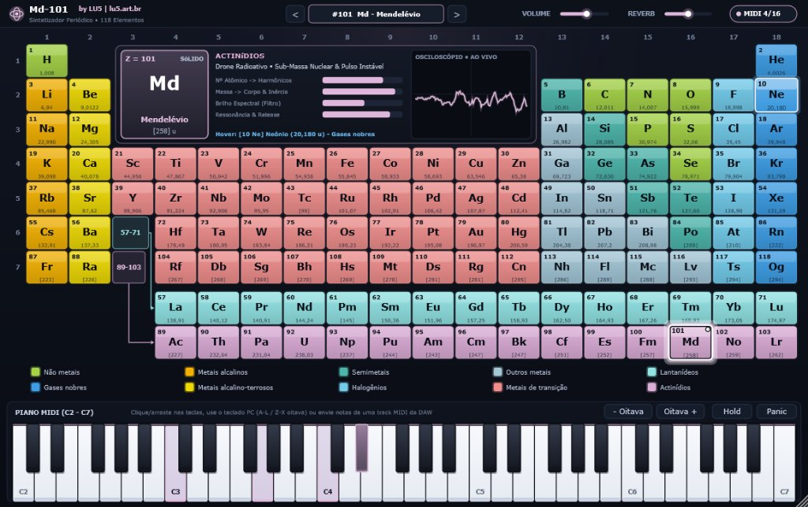

# Md-101 — Sintetizador VST3 Baseado na Tabela Periódica

**Md-101** é um instrumento virtual MIDI polifônico (16 vozes) desenvolvido por **LU5** ([lu5.art.br](https://lu5.art.br)) em **C++17 / JUCE 8**, compatível com **Windows** e **Linux** nos formatos **VST3** (para qualquer DAW com suporte a MIDI) e **Standalone** (aplicativo independente).

Cada um dos **118 elementos químicos** da Tabela Periódica atua como um preset único de sintetizador, cujo timbre é calculado fisicamente a partir da **família química**, do **número atômico ($Z$)**, da **massa atômica ($A$)** e do **estado físico**.



---

## Documentação do Projeto

- 📘 **[Manual do Usuário (Markdown)](docs/MANUAL.md)**: Guia passo a passo de instalação, performance com teclado do computador e mouse, uso nas principais DAWs (Reaper, Waveform, Ableton, FL Studio, Cubase, etc.) e guia tímbrico das 10 famílias.
- 🌐 **[Manual do Usuário em HTML](docs/manual.html)**: Versão visual para navegador com guia da interface, atalhos de performance, tabela de DAWs recomendadas (Reaper, Waveform, etc.), características das 10 famílias químicas e FAQ.
- ⚙️ **[Arquitetura de Software e Engenharia DSP](docs/ARCHITECTURE.md)**: Documentação técnica com diagramas de classes, modelo de threads e concorrência, formulações matemáticas do filtro TPT SVF 24 dB/oct, algoritmos PolyBLEP anti-aliasing, alocação de 16 vozes e suíte de testes.

---

## Por que o nome **Md-101**?

O nome **Md-101** une dois universos fundamentais deste projeto — a **Química Periódica** e a **História dos Sintetizadores Clássicos**:

1. **Homenagem a Dmitri Mendeleev e ao elemento Mendelévio (`Md`, $Z = 101$)**:
   Em 1869, o químico russo **Dmitri Ivanovich Mendeleev** formulou a Lei Periódica e organizou os elementos químicos por massa atômica e propriedades recorrentes — chegando a prever com precisão as propriedades de elementos que ainda nem haviam sido descobertos. O símbolo **`Md`** e o número atômico **`101`** identificam diretamente o elemento batizado em sua honra.
2. **Tradição da nomenclatura dos sintetizadores lendários**:
   Na história da música eletrônica, os sintetizadores mais icônicos foram imortalizados por siglas alfanuméricas compostas por letras e números separadas por hífen — como o **Oberheim OB-X**, o **Yamaha DX-7**, o **Yamaha CS-80**, o **Roland SH-101**, o **Roland Juno-106** e o **Sequential Prophet-5**. **Md-101** soa naturalmente como um sintetizador clássico de estúdio, enquanto carrega em seu próprio código o símbolo químico (`Md`) e o número atômico (`101`) do criador da Tabela Periódica.

### A História do Elemento Mendelévio (`Md`, $Z = 101$)

O **Mendelévio** ($Z = 101$, série dos Actinídios) é um elemento sintético e radioativo, sintetizado pela primeira vez em **1955** na Universidade da Califórnia, Berkeley. Notabilizou-se como o primeiro elemento da história a ser produzido e identificado literalmente átomo por átomo (apenas 17 átomos no experimento inaugural).

Em pleno auge da Guerra Fria, os cientistas norte-americanos propuseram batizá-lo em homenagem ao químico russo **Dmitri Mendeleev**, reconhecendo a Tabela Periódica como fundamento essencial da química transurânica. No sintetizador, o preset **#101 Md** traduz essa natureza pesada e radioativa em um *drone* profundo e hipnótico, com modulações inarmônicas e cintilação textural nas altas frequências.

---

## Arquitetura Sonora (Química $\rightarrow$ DSP)

O motor de síntese (`PeriodicSynth::SynthEngine`) combina osciladores *Virtual Analog* anti-aliasing (*PolyBLEP*), síntese **FM de 2 operadores**, *wavefolding*, gerador de turbulência gasosa/cintilação nuclear, filtro **TPT State-Variable de 24 dB/oct** e cadeia estéreo de *Chorus + Reverb*.

### 1. Família Química (10 Categorias da Tabela de Referência)
Elementos de um mesmo grupo compartilham a mesma arquitetura de síntese, soando como integrantes de uma mesma família acústica:

| Categoria | Cor | Arquitetura Sonora |
| :--- | :--- | :--- |
| **Gases nobres** (`He`..`Og`) | `#3D9EE5` | *Pads* atmosféricos etéreos, sopro gasoso filtrado, ataque suave e longa reverberação espacial |
| **Não metais** (`H, C, N, O, P, S, Se`) | `#A3D246` | *Poly/Wind Synth* analógico orgânico; os gases diatômicos (`H, N, O`) incorporam sopro aéreo |
| **Halogênios** (`F`..`Ts`) | `#72CBEB` | *Leads/Pads* ácidos reativos e ionizados com filtro de alta ressonância e pulso assimétrico |
| **Metais alcalinos** (`Li`..`Fr`) | `#F3B202` | *Plucks* elétricos percussivos com centelha de *pitch* rápida no ataque |
| **Metais alcalino-terrosos** (`Be`..`Ra`) | `#EDD805` | *Brass-Poly* analógico encorpado com forte fundação sub-harmônica (`-1 oitava`) |
| **Metais de transição** (`Sc`..`Cn`) | `#EF8E8D` | Ressonadores/sinos metálicos **FM**, com razão harmônica modulada pela coluna do bloco *d* (`Fe`, `Cu`, `Ag`, `Au`, `Hg`...) |
| **Semimetais** (`B, Si, Ge, As, Sb, Te, Po`) | `#4DB6AC` | Timbres cristalinos semicondutores com *wavefolder* senoidal e harmônicos vítreos |
| **Outros metais** (`Al, Ga, In, Sn, Tl, Pb, Bi`...) | `#A3C7D7` | Metais maleáveis com *tines* elétricos quentes, saturação valvulada e *vibrato* dúctil |
| **Lantanídeos** (`La`..`Lu`) | `#92E3E4` | *Ensemble* luminescente de terras-raras com *super-harmônicos* desafinados e brilho a laser |
| **Actinídios** (`Ac`..`Lr`) | `#DCADD7` | *Drones* radioativos profundos com sub-massa nuclear, deriva instável e micro-cintilação *Geiger* |

### 2. Número Atômico ($Z = 1 \dots 118$)
- Controla a **complexidade eletrônica e riqueza harmônica**: índice de modulação FM sustentada, quantidade de harmônicos superiores, *drive* de *wavefolding* e abertura de desafinação em uníssono (*detune*).

### 3. Massa Atômica ($A = 1{,}008 \dots 294\text{ u}$)
- Controla a **inércia física e o centro de gravidade espectral**:
  - Elementos leves (`H`, `He`, `Li`, `Ne`) têm resposta ágil, corte de filtro brilhante e harmônicos cristalinos.
  - Elementos pesados (`W`, `Au`, `Pb`, `U`, `Md`, `Og`) apresentam maior peso sub-harmônico, timbre mais denso/escuro e cauda de ressonância (*decay/release*) mais longa.
  - O excesso de nêutrons $(A - 2Z)/A$ em elementos pesados adiciona batimento microtonal orgânico.

---

## Interface Escura & Controles

- **Tabela Periódica Interativa (118 Presets)**:
  - Cores fiéis à tabela de referência com aura luminosa (*glow*) sobre fundo escuro.
  - **Indicador de Hover**: halo brilhante, expansão suave da célula, borda clara e prévia instantânea no painel central.
  - **Indicador de Seleção**: moldura dupla de alto contraste, LED ativo no canto superior direito e aura reativa ao áudio.
  - **Legenda Interativa**: passar o mouse sobre uma das 10 categorias destaca todos os elementos daquela família química.
- **Painel Central (HUD + Osciloscópio)**:
  - Cartão ampliado do elemento ativo ($Z$, símbolo, nome em português, massa atômica e fase física), barras de mapeamento físico-sonoro e **osciloscópio estéreo em tempo real**.
- **Rodapé — Piano MIDI Tradicional**:
  - Teclas brancas e pretas tradicionais sensíveis à velocidade vertical do clique, suporte a *glissando* com o mouse, teclado do PC (`A`–`L` / `W`–`P`, `Z`/`X` para oitavas), botões de **Oitava**, **Hold (Sustain)** e **Panic**, além de iluminação em tempo real ao receber notas de uma **track MIDI da DAW**.

---

## Como Compilar

### Windows (Visual Studio 2022 + CMake/Ninja)
Execute na raiz do projeto:
```powershell
powershell -NoProfile -ExecutionPolicy Bypass -File .\build_windows.ps1
```

Artefatos gerados:
- **Plugin VST3**: `build\Md101_artefacts\Release\VST3\Md-101.vst3`
- **Standalone**: `build\Md101_artefacts\Release\Standalone\Md-101.exe`

Para instalar em qualquer DAW no Windows (Reaper, Ableton Live, FL Studio, Cubase, Studio One, Bitwig, etc.), copie a pasta `.vst3` inteira para:
```text
C:\Program Files\Common Files\VST3\Md-101.vst3
```

### Linux (GCC/Clang + CMake)
1. Instale as dependências de desenvolvimento do JUCE (Ubuntu / Debian):
```bash
sudo apt update
sudo apt install -y build-essential cmake pkg-config \
    libasound2-dev libfreetype6-dev libx11-dev libxinerama-dev \
    libxrandr-dev libxcursor-dev libxcomposite-dev mesa-common-dev
```
2. Compile e instale o plugin VST3:
```bash
chmod +x build_linux.sh
./build_linux.sh Release
mkdir -p ~/.vst3
cp -r build/Md101_artefacts/Release/VST3/Md-101.vst3 ~/.vst3/
```
Em seguida, reescaneie os plugins VST3 na sua DAW (Reaper, Bitwig, Ardour, Waveform, Carla, etc.) e insira **Md-101** como instrumento virtual em uma pista MIDI!

---

## Créditos e Autoria

Desenvolvido por **LU5** — conheça mais projetos de arte, música e tecnologia em **[lu5.art.br](https://lu5.art.br)**.

---

## Licença

Este projeto é disponibilizado sob a licença **MIT** (consulte o arquivo [LICENSE](LICENSE) para mais detalhes).
Note que, ao compilar e distribuir binários combinados com a versão de código aberto do framework JUCE, os termos da **GPLv3** do JUCE se aplicam à obra binária distribuída.
