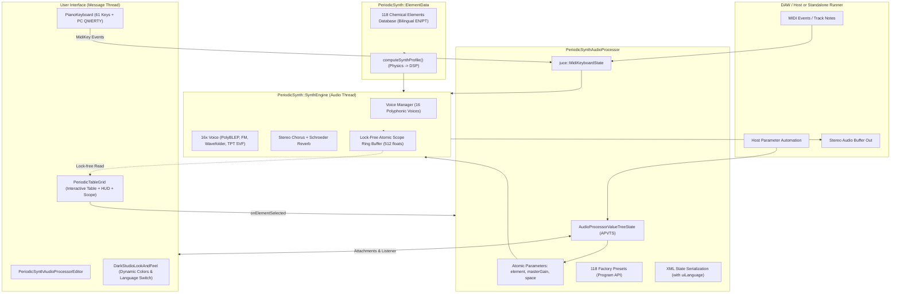
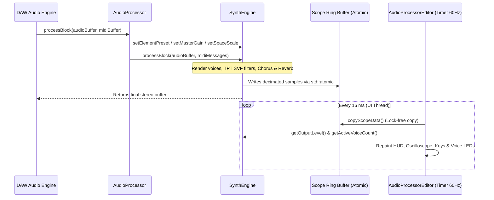
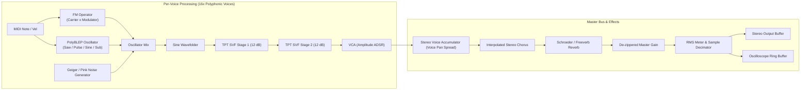
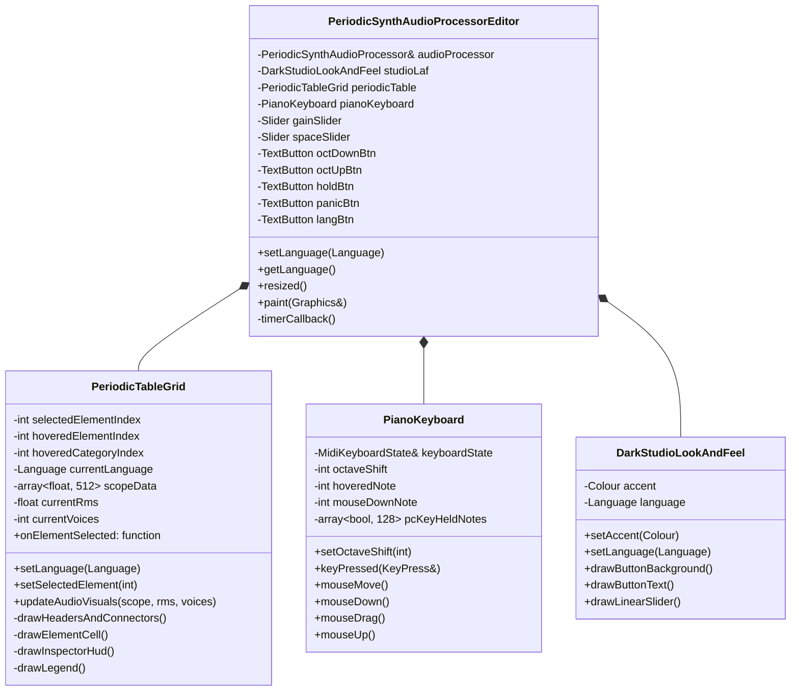

# Md-101 — Software Architecture & DSP Engineering

🌐 **Language / Idioma:** **English** | [Português (ARCHITECTURE.md)](ARCHITECTURE.md)

**Md-101** is a 16-voice polyphonic virtual MIDI instrument developed in **C++17** using the **JUCE 8** framework, available in **VST3** and **Standalone** formats for **Windows** and **Linux** platforms.

The foundational concept of the project is the **deterministic sonification of atomic physics and chemistry**: each of the 118 known chemical elements acts as an acoustic synthesis preset whose coefficients for oscillation, filtering, FM modulation, envelopes, and saturation are derived directly from the element's periodic properties.

---

## 1. System Architecture Overview

The system is organized into three fundamental layers:
1. **Host & State Management** (`PeriodicSynthAudioProcessor`): handles audio and MIDI I/O with the host DAW, XML session persistence, and synchronized parameter tree management (`juce::AudioProcessorValueTreeState`).
2. **DSP Synthesis Engine** (`PeriodicSynth::SynthEngine`): real-time execution on the *Audio Thread*, responsible for 16-voice polyphonic allocation, *PolyBLEP* anti-aliased oscillators, FM modulation, 24 dB/oct Cytomic TPT SVF filtering, a stereo Chorus/Reverb FX chain, and a lock-free oscilloscope ring buffer.
3. **Reactive Graphical Interface** (`PeriodicSynthAudioProcessorEditor`, `PeriodicTableGrid`, `PianoKeyboard`): UI rendering on the *Message Thread* at 60 FPS featuring an atomic telemetry HUD, live stereo oscilloscope, and a virtual keyboard with vertical velocity detection and bilingual UI support (`EN | PT`).



---

## 2. Concurrency & Threading Model

The synthesizer strictly adheres to real-time professional audio development standards:
- **Audio Thread (Real-Time)**:
  - Runs inside `processBlock()`.
  - **Zero heap memory allocations** (`new`, `malloc`, `std::vector::resize`, `std::string`) during playback.
  - **Zero blocking calls** (mutexes, locks, semaphores, disk/network I/O).
  - Parameter communication with the UI through atomic variables (`std::atomic<float>`, `std::atomic<int>`, `std::atomic<bool>`) using `std::memory_order_relaxed`.
- **Message Thread (Graphical Interface)**:
  - Runs on the operating system's main UI thread.
  - Triggered every 16–20 ms (~60 Hz) via `juce::Timer::timerCallback()` in `PeriodicSynthAudioProcessorEditor`.
  - Reads the atomic oscilloscope buffer (`SynthEngine::copyScopeData`), current RMS level, active voice count, and language preference without stalling the audio stream.



---

## 3. Chemical Data Model (`ElementData.h` / `ElementData.cpp`)

Each chemical element is represented by the `ElementInfo` structure:

```cpp
struct ElementInfo
{
    int atomicNumber;               // Z = 1..118
    const char* symbol;             // "H" .. "Og"
    const char* namePt;             // Official name in Portuguese
    const char* nameEn;             // IUPAC English element name
    float atomicMass;               // Numerical atomic mass (u)
    const char* massDisplay;        // Formatted display string ("1,008", "[294]")
    ElementCategory category;       // 10 chemical families
    PhysicalPhase phase;            // Solid, Liquid, Gas
    int period;                     // 1..7
    int group;                      // 1..18 (0 for f-block Lanthanides/Actinides)
    int gridRow;                    // 0..8 (row index in 18x9 layout)
    int gridCol;                    // 0..17
    bool isRadioactive;             // Z = 43, 61, or >= 84
};
```

### The `computeSynthProfile(element)` Algorithm

The translation of elemental physics into synthesizer parameters (`ElementSynthProfile`) is computed deterministically:

1. **Normalized Physical Variables**:
   $$\text{normZ} = \frac{Z - 1}{117}$$
   $$\text{normMass} = \frac{\log_{10}(A) - \log_{10}(1.008)}{\log_{10}(294.0) - \log_{10}(1.008)}$$

2. **Mapping the 10 Chemical Families**:

| Chemical Family | Oscillator Architecture | Filtering & Modulation | Dynamic Response |
| :--- | :--- | :--- | :--- |
| **Noble Gases** | Pure sine fundamental + airy breath noise layer | TPT filter with gentle cutoff and low resonance | Long attack (0.15s), long decay, expansive reverb (room 0.85) |
| **Nonmetals** | Sine/analog pulse blend; diatomic gases add turbulence | Key-tracked lowpass TPT filter | Balanced, organic acoustic response |
| **Halogens** | Asymmetric narrow pulse | High resonance (0.65..0.78) and envelope modulation | Biting, reactive acid leads |
| **Alkali Metals** | Bright pulse + fast attack pitch chirp | Fast pitch spark decay (+7 to +14 semitones) | Instant, punchy percussive plucks |
| **Alkaline Earth Metals** | Analog sawtooth + sub-oscillator (-1 octave) | 24 dB filter with gentle cutoff saturation | Dense, authoritative brass-poly character |
| **Transition Metals** | 2-operator FM synthesis with column-dependent harmonic ratio ($g = 3 \dots 12$) | Transient FM strike and sustained modulation | Metallic FM bells, chimes, and resonators |
| **Semimetals** | Sine wave with non-linear wavefolding | Bandpass formants with glassy resonance | Crystalline semiconductor timbres |
| **Other Metals** | 1.0 or 2.0 ratio FM with tube saturation | Moderate cutoff and even-harmonic saturation | Warm electric tines (Rhodes / Wurlitzer style) |
| **Lanthanides** | Super-harmonics (+1 and +2 octaves) and unison detuning | Bright lowpass with slow LFO modulation | Luminescent rare-earth ensemble |
| **Actinides** | Heavy sub-harmonics + stochastic Geiger scintillation | Dark filter with slow pitch drift instability | Deep radioactive drones |

---

## 4. `SynthEngine` Audio Pipeline



### 4.1. PolyBLEP Anti-Aliasing Algorithm

To prevent harmonic reflection (*aliasing*) at high frequencies in sawtooth and pulse oscillators, the engine implements polynomial band-limited step (PolyBLEP) residual correction:

```cpp
float polyBlep (double t, double dt) noexcept
{
    if (t < dt)
    {
        t /= dt;
        return static_cast<float> (t + t - t * t - 1.0);
    }
    if (t > 1.0 - dt)
    {
        t = (t - 1.0) / dt;
        return static_cast<float> (t * t + t + t + 1.0);
    }
    return 0.0f;
}
```

### 4.2. 24 dB/octave Cytomic TPT State-Variable Filter (SVF)

The synthesis engine adopts Vadim Zavalishin's Topology-Preserving Transform (TPT) State-Variable Filter model. This model preserves continuous-time analog topology through the bilinear transform without introducing destabilizing feedback unit delays:

$$\begin{aligned}
a_1 &= \frac{1}{1 + g(g + k)} \\
a_2 &= g \cdot a_1 \\
a_3 &= g \cdot a_2 \\
v_3 &= x - s_2 \\
v_1 &= a_1 s_1 + a_2 v_3 \\
v_2 &= s_2 + a_2 s_1 + a_3 v_3 \\
s_1 &\leftarrow 2 v_1 - s_1 \\
s_2 &\leftarrow 2 v_2 - s_2
\end{aligned}$$

By cascading two identical 2-pole stages in series (`svf1` and `svf2`), the synthesizer attains a steep **24 dB per octave** roll-off with continuous control over resonance ($k$) and cutoff frequency ($g = \tan(\pi f_c / f_s)$).

### 4.3. Non-Linear Wavefolding

For semimetals (such as Silicon, Germanium, and Boron), a digital wavefolding circuit generates glassy upper overtones:

$$y = \sin\left(\text{drive} \cdot x\right)$$

### 4.4. Geiger Stochastic Nuclear Scintillation Generator

For radioactive elements ($Z=43$, $Z=61$, and all $Z \ge 84$), the engine injects stochastic high-energy pulses driven by a single-cycle `Xorshift32` pseudo-random generator:

```cpp
voice.rngState ^= (voice.rngState << 13);
voice.rngState ^= (voice.rngState >> 17);
voice.rngState ^= (voice.rngState << 5);
if ((voice.rngState & 0x01FFu) == 0) // Threshold-based random burst
    voice.geigerEnv = 1.0f;
```

---

## 5. Graphical Interface Class Hierarchy



---

## 6. State Persistence & DAW Integration

- **Preset Synchronization**:
  The `PeriodicSynthAudioProcessor::setCurrentProgram(index)` method syncs all 118 presets with the DAW's native program selector. When choosing a preset from the DAW host interface, the `element` parameter in the APVTS is signaled via `setValueNotifyingHost()`.
- **Session Save / Restore**:
  - `getStateInformation()` exports the `apvts.copyState()` parameter tree and the `uiLanguage` attribute as binary-compressed XML.
  - `setStateInformation()` restores previous settings, updating active element preset, language toggle, and synthesis parameters instantaneously.

---

## 7. Automated Verification Suite (`VerifyPlugin.cpp`)

The automated verification binary (`Md101Verify`) verifies system integrity across all layers before every release:
1. **Chemical Database Validation**:
   - Validates atomic numbers ($Z = 1 \dots 118$), positive atomic masses, and bilingual names (`nameEn` and `namePt`).
   - Ensures no element cell overlaps the central HUD area (rows 0..2, cols 2..11) or the f-block connector cells (5,2 and 6,2).
   - Validates exact counts for all 10 chemical categories.
2. **Preset & State Validation**:
   - Ensures all 118 programs are accessible via the VST3 API.
   - Verifies XML serialization and deserialization of plugin state including `uiLanguage`.
3. **DSP Audio Stress Testing**:
   - Instantiates the processor at 44.1 kHz, triggers 16-note polyphony, and verifies that output audio is finite, clean, non-clipping, and free of NaNs/Infs.
   - Evaluates spectral centroid proxies to confirm that lighter homologues ($H$, $He$, $Li$) are brighter than heavier homologues ($Rn$, $Cs$).
4. **Headless UI & Bilingual Switch Verification**:
   - Instantiates the graphical editor offscreen, verifies layout bounds and metrics, and checks programmatic toggling of the top-bar `EN | PT` language button.
   - Generates verified reference snapshots in both languages for visual inspection.
