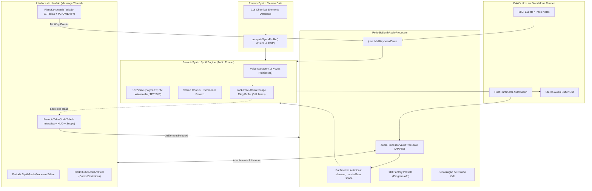
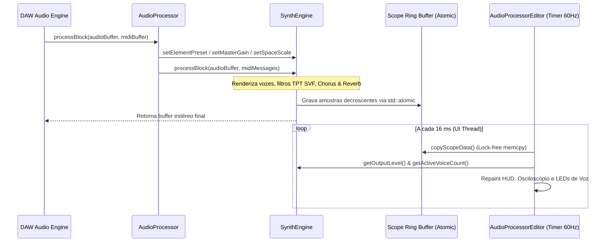
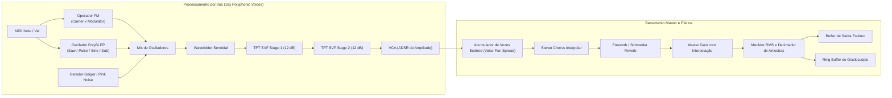
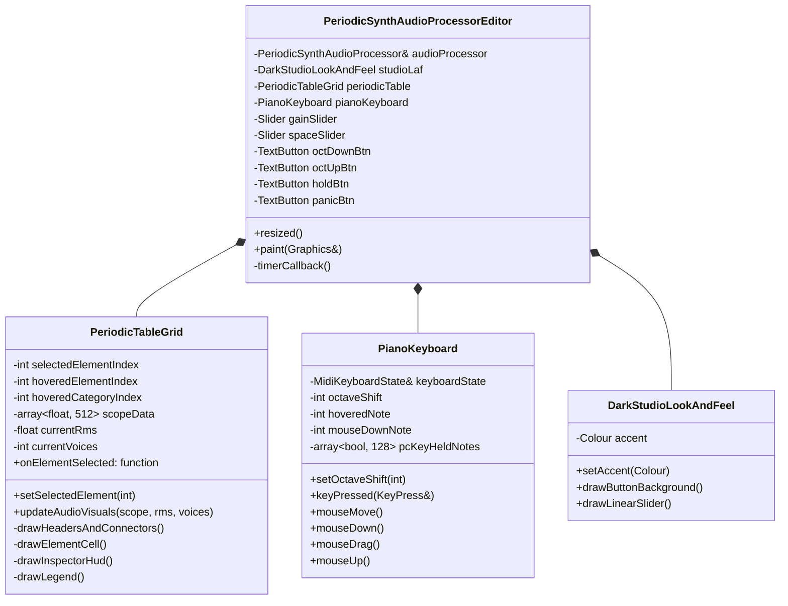

# Md-101 — Arquitetura de Software e Engenharia DSP

🌐 **Idioma / Language:** **Português** | [English (ARCHITECTURE-en.md)](ARCHITECTURE-en.md)

O **Md-101** é um instrumento virtual MIDI polifônico (16 vozes) desenvolvido em **C++17** utilizando o framework **JUCE 8**, disponível nos formatos **VST3** e **Standalone** para plataformas **Windows** e **Linux**.

O conceito central do projeto é a **sonificação determinística da física e química atômica**: cada um dos 118 elementos químicos conhecidos atua como um preset de síntese acústica cujos coeficientes de oscilação, filtragem, modulação FM, envelope e saturação derivam das propriedades periódicas do elemento.

---

## 1. Visão Geral da Arquitetura do Sistema

O sistema é dividido em três camadas fundamentais:
1. **Host & State Management** (`PeriodicSynthAudioProcessor`): gerenciamento de I/O de áudio e MIDI com a DAW, persistência de sessão XML e árvore de parâmetros sincronizada (`juce::AudioProcessorValueTreeState`).
2. **Motor de Síntese DSP** (`PeriodicSynth::SynthEngine`): execução em tempo real na *Audio Thread*, responsável por alocação polifônica de 16 vozes, osciladores *PolyBLEP*, modulação FM, filtragem TPT SVF 24 dB/oct, cadeia estéreo de Chorus/Reverb e buffer lock-free de osciloscópio.
3. **Interface Gráfica Reativa** (`PeriodicSynthAudioProcessorEditor`, `PeriodicTableGrid`, `PianoKeyboard`): renderização gráfica na *Message Thread* a 60 FPS com HUD de parâmetros químicos, osciloscópio estéreo e teclado virtual com detecção de velocidade por toque vertical.



---

## 2. Modelo de Concorrência e Threads (Threading Model)

O sintetizador opera sob o padrão estrito de áudio em tempo real:
- **Audio Thread (Tempo Real)**:
  - Executa dentro de `processBlock()`.
  - **Zero alocações de memória heap** (`new`, `malloc`, `std::vector::resize`, `std::string`) durante a reprodução.
  - **Zero chamadas bloqueantes** (mutexes, locks, semáforos, I/O de disco).
  - Comunicação de parâmetros com a UI através de variáveis atômicas (`std::atomic<float>`, `std::atomic<int>`, `std::atomic<bool>`) com `std::memory_order_relaxed`.
- **Message Thread (Interface Gráfica)**:
  - Executa na thread principal do sistema operacional.
  - Disparada a cada 16–20 ms (~60 Hz) pelo `juce::Timer::timerCallback()` em `PeriodicSynthAudioProcessorEditor`.
  - Lê o buffer atômico de osciloscópio (`SynthEngine::copyScopeData`), o RMS atual e o número de vozes ativas sem bloquear o fluxo de áudio.



---

## 3. Modelo de Dados Químico (`ElementData.h` / `ElementData.cpp`)

Cada elemento químico é representado pela estrutura `ElementInfo`:

```cpp
struct ElementInfo
{
    int atomicNumber;               // Z = 1..118
    const char* symbol;             // "H" .. "Og"
    const char* namePt;             // Nome oficial em Português
    float atomicMass;               // Massa atômica numérica (u)
    const char* massDisplay;        // Texto de exibição formatado ("1,008", "[294]")
    ElementCategory category;       // 10 famílias químicas
    PhysicalPhase phase;            // Solid, Liquid, Gas
    int period;                     // 1..7
    int group;                      // 1..18 (0 para f-block)
    int gridRow;                    // 0..8 (posicionamento no grid de 18x9)
    int gridCol;                    // 0..17
    bool isRadioactive;             // Z = 43, 61 ou >= 84
};
```

### O Algoritmo `computeSynthProfile(element)`

A conversão da física do elemento para os parâmetros do sintetizador (`ElementSynthProfile`) é computada de forma determinística:

1. **Normalização de Grandezas**:
   $$\text{normZ} = \frac{Z - 1}{117}$$
   $$\text{normMass} = \frac{\log_{10}(A) - \log_{10}(1.008)}{\log_{10}(294.0) - \log_{10}(1.008)}$$

2. **Mapeamento das 10 Famílias Químicas**:

| Família | Arquitetura de Oscilador | Filtragem & Modulação | Resposta Dinâmica |
| :--- | :--- | :--- | :--- |
| **Gases Nobres** | Senóide fundamental + ruído de sopro aéreo | Filtro TPT com corte suave e ressonância baixa | Ataque longo (0.15s), decay longo, reverb amplo (room 0.85) |
| **Não Metais** | Mistura senóide/pulso analógico; gases diatômicos têm componente de turbulência | TPT passa-baixas chaveado por nota (*key-tracked*) | Resposta orgânica equilibrada |
| **Halogênios** | Pulso estreito assimétrico (*narrow pulse*) | Ressonância alta (0.65..0.78) e modulação por envelope | Timbres ácidos reativos (*acid leads*) |
| **Metais Alcalinos** | Pulso brilhante + pulso inicial de pitch | Decay rápido de centelha (*pitch spark*) de +7 a +14 semitons | *Plucks* percussivos instantâneos |
| **Metais Alcalino-terrosos** | Dente-de-serra analógica + sub-oscilador (-1 oitava) | Filtro de 24 dB com saturação no corte | Sonoridade encorpada tipo *Brass* |
| **Metais de Transição** | Síntese FM de 2 operadores com ratio harmônico dependente da coluna ($g = 3 \dots 12$) | Modulação transiente de FM (*strike*) e sustentada | Sinos e ressonadores metálicos inarmônicos |
| **Semimetais** | Senóide com saturação por *wavefolding* não-linear | Formantes de passa-faixa com ressonância vítrea | Timbres cristalinos semicondutores |
| **Outros Metais** | FM de razão 1.0 ou 2.0 com saturação valvulada | Corte moderado e saturação harmônica par | Tines elétricos quentes (estilo Rhodes / Wurlitzer) |
| **Lantanídeos** | Super-harmônicos (+1 e +2 oitavas) e *unison detune* | Passa-baixas brilhante com modulação LFO lenta | Sonoridade de *ensemble* luminescente |
| **Actinídios** | Sub-harmônicos pesados + cintilação Geiger estocástica | Filtro escuro com instabilidade lenta de afinação | Drones radioativos profundos |

---

## 4. Pipeline de Áudio do `SynthEngine`



### 4.1. Algoritmo PolyBLEP (Anti-Aliasing)

Para evitar ruídos de espelhamento harmônico (*aliasing*) em altas frequências nos osciladores dente-de-serra e pulso, o motor implementa o algoritmo de interpolação polinomial residual PolyBLEP:

```cpp
float polyBlep (double t, double dt) noexcept
{
    if (t < dt)
    {
        t /= dt;
        return static_cast<float> (t + t - t * t - 1.0);
    }
    if (t > 1.0 - dt)
    {
        t = (t - 1.0) / dt;
        return static_cast<float> (t * t + t + t + 1.0);
    }
    return 0.0f;
}
```

### 4.2. Filtro TPT SVF (Topology-Preserving Transform) de 24 dB/oitava

O motor de síntese adota o modelo TPT State-Variable Filter de Vadim Zavalishin. O modelo preserva a topologia analógica em tempo contínuo através da transformação bilinear sem introduzir atrasos de realimentação desestabilizadores:

$$\begin{aligned}
a_1 &= \frac{1}{1 + g(g + k)} \\
a_2 &= g \cdot a_1 \\
a_3 &= g \cdot a_2 \\
v_3 &= x - s_2 \\
v_1 &= a_1 s_1 + a_2 v_3 \\
v_2 &= s_2 + a_2 s_1 + a_3 v_3 \\
s_1 &\leftarrow 2 v_1 - s_1 \\
s_2 &\leftarrow 2 v_2 - s_2
\end{aligned}$$

Ao encadear dois estágios idênticos em série (`svf1` e `svf2`), o sintetizador obtém uma atenuação de **24 dB por oitava** com controle contínuo de ressonância ($k$) e frequência de corte ($g = \tan(\pi f_c / f_s)$).

### 4.3. Wavefolding Não-Linear

Para os elementos semimetais (como Silício, Germânio e Boro), um circuito digital de dobra de onda (*wavefolding*) adiciona harmônicos vítreos:

$$y = \sin\left(\text{drive} \cdot x\right)$$

### 4.4. Gerador de Cintilação Nuclear Geiger

Para elementos radioativos ($Z=43$, $Z=61$ e todos com $Z \ge 84$), o sintetizador injeta pulsos estocásticos de alta energia gerados por um gerador pseudoaleatório `Xorshift32` de ciclo único:

```cpp
voice.rngState ^= (voice.rngState << 13);
voice.rngState ^= (voice.rngState >> 17);
voice.rngState ^= (voice.rngState << 5);
if ((voice.rngState & 0x01FFu) == 0) // Disparo aleatório por limiar
    voice.geigerEnv = 1.0f;
```

---

## 5. Estrutura de Classes da Interface Gráfica



---

## 6. Persistência de Estado e Integração com DAW

- **Sincronização de Presets**:
  O método `PeriodicSynthAudioProcessor::setCurrentProgram(index)` sincroniza os 118 presets com a lista de programas nativa da DAW. Ao selecionar um preset na interface da DAW, o parâmetro `element` no APVTS é notificado via `setValueNotifyingHost()`.
- **Salvar / Restaurar Projeto da DAW**:
  - `getStateInformation()` exporta a árvore de parâmetros `apvts.copyState()` em formato binário comprimido XML.
  - `setStateInformation()` reconstitui o estado anterior e atualiza instantaneamente o preset selecionado e o motor de síntese.

---

## 7. Suíte de Testes Automatizados (`VerifyPlugin.cpp`)

O executável de verificação (`Md101Verify`) garante a integridade de todas as camadas antes da liberação de cada release:
1. **Validação do Banco Químico**:
   - Confere número atômico ($Z = 1 \dots 118$) e massas positivas.
   - Garante que nenhuma célula colida ou sobreponha o HUD central (linhas 0..2, colunas 2..11) ou os conectores f-block (5,2 e 6,2).
   - Confere a contagem exata dos 118 elementos pelas 10 categorias de referência.
2. **Validação de Presets e Estado**:
   - Verifica se os 118 programas estão acessíveis pela API VST3.
   - Executa teste de serialização e restauração do XML de estado.
3. **Teste de Estresse de Áudio DSP**:
   - Instancia o processador a 44.1 kHz, dispara polifonia total de 16 notas MIDI e verifica estabilidade sem estouro de valor (NaN/Inf).
   - Valida o centroide espectral comparando elementos leves ($H$, $He$) com elementos pesados ($Pb$, $U$, $Md$) para comprovar o comportamento físico no domínio da frequência.
4. **Verificação de Instanciação da Interface**:
   - Cria o editor gráfico em ambiente *headless* para checar bounds, métricas do grid e componentes de layout sem falhas de segmentação.
