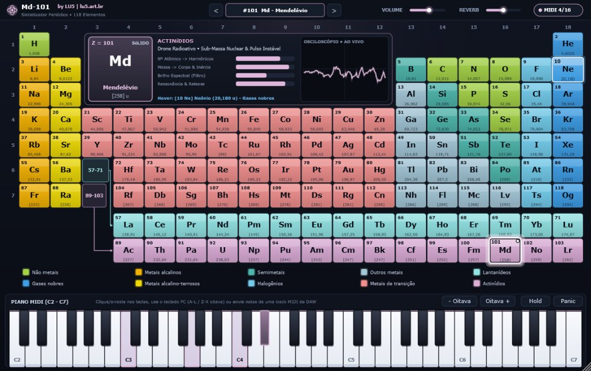

# Md-101 — User Manual

🌐 **Language / Idioma:** **English** | [Português (MANUAL.md)](MANUAL.md) | [Interactive HTML Manual (manual-en.html)](manual-en.html)

16-Voice Polyphonic VST3 and Standalone Virtual Instrument Based on the Periodic Table of Chemical Elements.  
Developed by **LU5** ([lu5.art.br](https://lu5.art.br)).

---

## 1. Introduction

**Md-101** is an innovative musical synthesizer where the matter of chemistry becomes sound. Each of the **118 chemical elements of the Periodic Table** acts as a unique preset, physically modeled in real time through acoustic equations translating atomic properties into sound synthesis:
- The **Atomic Number ($Z$)** governs electron density, reflected in harmonic richness, sustained FM modulation index, and unison detuning.
- The **Atomic Mass ($A$)** dictates acoustic inertia: lighter elements sound agile and airy, while heavier elements deliver deep sub-bass weight, denser textures, and long resonant tails.
- The **Chemical Family** defines the fundamental synthesis architecture: gaseous atmospheric pads, metallic FM bells, analog brass poly-synths, electric plucks, crystalline semiconductor saturation, and heavy nuclear drones.

---

## 2. System Requirements & Installation

### Minimum Requirements
- **Operating System**:
  - Windows 10 or 11 (64-bit).
  - Linux (Ubuntu 20.04+, Debian 11+, Fedora, Arch Linux, or any distribution with GLIBC 2.31+ and ALSA / JACK / PipeWire audio server).
- **Formats**: VST3 (64-bit) and Standalone application.
- **Compatible DAWs**: Any Digital Audio Workstation supporting 64-bit VST3 virtual instruments (Cockos Reaper, Tracktion Waveform, Ableton Live, FL Studio, Steinberg Cubase, PreSonus Studio One, Bitwig Studio, Ardour, Carla, etc.).

### Installation on Windows
1. Download or compile the `Md-101.vst3` bundle.
2. Copy the entire `Md-101.vst3` folder into the standard Windows 64-bit VST3 directory:
   ```text
   C:\Program Files\Common Files\VST3\Md-101.vst3
   ```
3. To use as a standalone desktop application (no DAW required), run `Md-101.exe` directly.

### Installation on Linux
1. Copy the compiled `Md-101.vst3` directory to your user's personal VST3 folder:
   ```bash
   mkdir -p ~/.vst3
   cp -r Md-101.vst3 ~/.vst3/
   ```
2. Open your DAW and perform a plugin rescan (*Rescan VST3 Plugins*).
3. For the Standalone version, ensure execute permissions and run:
   ```bash
   chmod +x Md-101
   ./Md-101
   ```

### Recommended DAW Configurations

| DAW / Host | Track Type | Recommended Setup |
| :--- | :--- | :--- |
| **Cockos Reaper** | Virtual Instrument on New Track | Insert via *"Insert > Virtual instrument on new track"*. Reaper automatically detects 16 polyphonic voices, maps MIDI channel 1, and synchronizes all 118 atomic presets into its native program list. |
| **Tracktion Waveform** | MIDI / Plugin Track (VST3) | Add **Md-101** directly into the MIDI track's plugin chain. Full envelope automation support for `element`, `masterGain`, and `space` parameters with native stereo routing. |
| **Ableton Live** | MIDI Track | Drag Md-101 onto a MIDI track; trigger via MIDI clips or controller keyboard. The `element` parameter automation is accessible through Clip envelopes. |
| **FL Studio** | Channel Rack (Plugin Instrument) | Add via Plugin Manager; use the standard Piano Roll to compose melodies and send vertical velocity per note. |
| **Steinberg Cubase / Nuendo** | Instrument Track (VST3) | Native recognition of 118 presets in the track inspector's VST3 program bar with zero latency and 64-bit stereo processing. |
| **PreSonus Studio One** | Instrument Track | Drag from the *Instruments* browser tab; seamless reverb and continuous automation support. |
| **Bitwig Studio** | Instrument Track | Complete modular integration; compatible with external LFO modulators and custom envelopes applied to gain and space. |

---

## 3. Graphical User Interface (UI) Guide

The Md-101 interface is designed for high contrast and visual immersion (*Dark Studio*):



### 3.1. Top Control Bar & Language Selector
- **Preset Navigation (`<` and `>`)**: Step sequentially forward and backward through all 118 periodic elements.
- **Language Switcher (`EN | PT`)**: Instantly toggle the entire interface between **English** and **Portuguese** with a single click. The selected language is saved directly with your DAW project session.
- **Master Volume**: Smooth, de-zippered output gain control preventing digital clicks and pops.
- **Ambience / Reverb**: Regulates spatial reverb depth and stereo chorus spreading.
- **Active Voice Monitor (`MIDI 0/16`)**: Real-time LED and voice count indicator reflecting active polyphony.

### 3.2. Interactive Periodic Table (118 Presets)
- **One-Click Preset Loading**: Left-click any element cell to immediately load its sound preset.
- **Active Frame & Corner LED**: The selected element displays a high-contrast double border, an active indicator dot, and an audio-reactive glow.
- **Hover Preview**: Hovering over any element previews its atomic number, mass, name, and chemical family in the center HUD without having to click.
- **Interactive Legend**: Hovering over any of the 10 chemical categories highlights all corresponding elements on the table; clicking a category auditions its first element.

### 3.3. Center Inspector Panel (HUD & Live Oscilloscope)
- **Atomic Preset Card**: Displays the Atomic Number ($Z$), Chemical Symbol, localized element name, Atomic Mass, and physical phase at STP (*Solid*, *Liquid*, or *Gas*).
- **Physical-to-Sonic Telemetry Meters**:
  - *Atomic No. -> Harmonics*: Electronic shell complexity and FM modulation depth.
  - *Mass -> Body & Inertia*: Low-end mass, sub-harmonic weight (-1 octave), and momentum.
  - *Spectral Brightness (Filter)*: Filter cutoff tracking and upper harmonic presence.
  - *Resonance & Release*: Envelope tail momentum and spatial resonance.
- **Real-Time Stereo Oscilloscope**: Shows the exact live waveform generated by active voices, reflecting filter, FM, and saturation shaping. When idle, shows the characteristic signature of the active preset.

### 3.4. Traditional 61-Key MIDI Keyboard & Performance Controls
- **Vertical Velocity Sensitivity**:
  - Clicking near the **bottom edge** of a key produces maximum velocity (forte, *vel = 127*).
  - Clicking near the **top edge** produces soft, delicate dynamics (*piano/pianissimo*).
- **Mouse Glissando**: Hold the left mouse button down and drag across the keys for continuous glissandos.
- **Computer QWERTY Keyboard Playback**:
  - White keys: `A`, `S`, `D`, `F`, `G`, `H`, `J`, `K`, `L`, `;`
  - Black keys: `W`, `E`, `T`, `Y`, `U`, `O`, `P`
  - Octave Shift: `Z` (one octave down) and `X` (one octave up).
- **`- Octave` and `Octave +` Buttons**: Shift the 61-key playing range by up to $\pm 2$ octaves (spanning $C_0$ to $C_9$).
- **`Hold` (Virtual Sustain)**: Latches triggered notes to sound continuously for drones and ambient pads.
- **`Panic` Button**: Sends an immediate *All Notes Off* command and clears all active voices.
- **DAW MIDI Illumination**: Incoming MIDI notes from external controllers or DAW tracks light up keys in real time.

---

## 4. The 10 Chemical Families & Sound Characteristics

| Chemical Family | Official Color | Timbral Character | Recommended Musical Role | Notable Examples |
| :--- | :--- | :--- | :--- | :--- |
| **Noble gases** | Cyan Blue (`#3D9EE5`) | Ethereal pads, filtered gaseous breath, soft attack, and vast spatial reverb | Atmospheric harmonic beds, film scores, ambient music | **#2 He** (Helium), **#10 Ne** (Neon), **#118 Og** (Oganesson) |
| **Nonmetals** | Lime Green (`#A3D246`) | Organic analog poly-synths and wind instruments; diatomic gases feature air turbulence | Warm melodic leads, expressive chords, gentle keys | **#1 H** (Hydrogen), **#6 C** (Carbon), **#8 O** (Oxygen) |
| **Halogens** | Sky Blue (`#72CBEB`) | Aggressive acid timbres, narrow pulse waves, and high filter resonance | Acid leads, biting arpeggios, cutting synth basses | **#9 F** (Fluorine), **#17 Cl** (Chlorine), **#53 I** (Iodine) |
| **Alkali metals** | Golden Amber (`#F3B202`) | Bright percussive plucks with an ultrafast pitch spark transient on attack | Fast arpeggios, tonal percussion, modern punchy plucks | **#3 Li** (Lithium), **#11 Na** (Sodium), **#19 K** (Potassium) |
| **Alkaline earth metals** | Gold Yellow (`#EDD805`) | Grounded, full-bodied brass-poly with a solid sub-harmonic foundation | Synthetic symphonic brass, vigorous synth chords | **#4 Be** (Beryllium), **#12 Mg** (Magnesium), **#20 Ca** (Calcium) |
| **Transition metals** | Coral Pink (`#EF8E8D`) | Metallic FM resonators and bells, with frequency ratios driven by the *d*-block column | Harmonic bells, metallic marimbas, inharmonic chimes, gongs | **#26 Fe** (Iron), **#29 Cu** (Copper), **#79 Au** (Gold) |
| **Semimetals** | Petroleum Teal (`#4DB6AC`) | Crystalline timbres with sinusoidal wavefolding and glassy harmonic saturation | Bright digital pianos, futuristic sci-fi textures | **#5 B** (Boron), **#14 Si** (Silicon), **#32 Ge** (Germanium) |
| **Other metals** | Steel Blue (`#A3C7D7`) | Warm electric tines, gentle tube saturation, and ductile vibrato | Vintage electric pianos (Rhodes / Wurlitzer style), neo-soul | **#13 Al** (Aluminium), **#50 Sn** (Tin), **#82 Pb** (Lead) |
| **Lanthanides** | Turquoise Sky (`#92E3E4`) | Rare-earth ensemble with detuned super-harmonics and laser-like shimmer | Shimmering ensemble textures, luminescent leads | **#57 La** (Lanthanum), **#60 Nd** (Neodymium) |
| **Actinides** | Mallow Rose (`#DCADD7`) | Deep nuclear drones with colossal sub-bass weight and stochastic Geiger scintillation | Heavy bass drones, industrial rumbles, dark sci-fi FX | **#92 U** (Uranium), **#94 Pu** (Plutonium), **#101 Md** (Mendelevium) |

---

## 5. Music Production Tips with Md-101

### Real-Time Element Automation
The **`element`** parameter is fully automatable in any DAW. You can draw an automation curve so that a repeated MIDI pattern transitions dynamically across the song:
- Start with **Hydrogen (#1 H)** during the intro, transition to **Gold (#79 Au)** during the build-up, and drop into **Uranium (#92 U)** or **Mendelevium (#101 Md)** on the drop!
- Because preset switching in Md-101 is glitch-free, transitions remain musical and smooth.

### Designing Massive Basses
For bass sounds with deep sub-bass authority, explore the heavy elements of periods 6 and 7, such as **Lead (#82 Pb)**, **Radon (#86 Rn)**, and **Mendelevium (#101 Md)**. Their higher atomic mass automatically biases the engine towards heavier sub-oscillator levels and darker, weightier filter profiles.

### Creating FM Bells & Metallic Percussion
For melodic percussion and shimmering chimes, look to the central block of Transition Metals (**columns 3 through 12**). Elements with intermediate atomic mass (**#22 Ti**, **#29 Cu**, **#47 Ag**) offer clear ringing modes. Combine with higher **Ambience / Reverb** values for expansive spatial decays.

---

## 6. Troubleshooting (FAQ)

### The plugin does not appear in my DAW's instrument list
1. Ensure the `Md-101.vst3` bundle is installed into the standard VST3 folder:
   - Windows: `C:\Program Files\Common Files\VST3\`
   - Linux: `~/.vst3/`
2. In your DAW's preferences, perform a full plugin cache clear and rescan (*Clear Cache & Rescan*).
3. Ensure your DAW supports **64-bit VST3** plugins.

### Notes continue sounding without stopping
- Check whether the **`Hold`** button on the bottom toolbar is active (highlighted background). If active, click it to release.
- If your MIDI keyboard controller sent a stuck sustain pedal message, simply click the **`Panic`** button to silence all active voices immediately.

### No sound is produced when playing the virtual keyboard
- Check that the **Volume** slider at the top is not set to zero.
- If running inside a DAW, verify that the MIDI track is armed for recording/monitoring (*Record Arm / Input Monitor*) and routed to MIDI Channel 1.

---

## 7. Credits & Authorship

- **Design & Development**: **LU5** ([lu5.art.br](https://lu5.art.br))
- **Audio Framework**: JUCE 8 (Raw Material Software / PACE Anti-Piracy)
- **License**: MIT License (source code) / GPLv3 (distributed binaries linked with JUCE Community)
