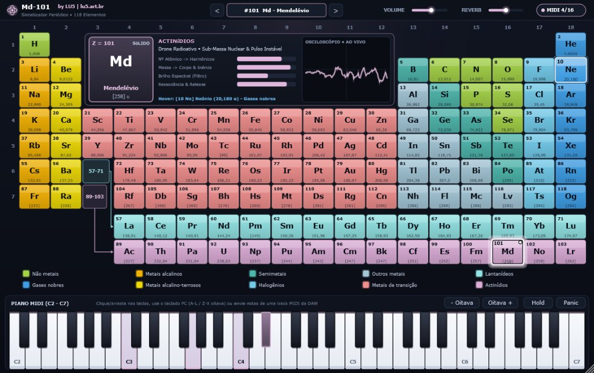

# Md-101 — Manual do Usuário

🌐 **Idioma / Language:** **Português** | [English (MANUAL-en.md)](MANUAL-en.md) | [Manual Visual HTML (manual.html)](manual.html)

Instrumento Virtual Polifônico VST3 e Standalone Baseado na Tabela Periódica dos Elementos Químicos.  
Desenvolvido por **LU5** ([lu5.art.br](https://lu5.art.br)).

---

## 1. Introdução

O **Md-101** é um sintetizador musical inovador onde a matéria da química se transforma em som. Cada um dos **118 elementos da Tabela Periódica** é um preset único, modelado em tempo real através de equações físicas que traduzem propriedades atômicas em síntese sonora:
- O **Número Atômico ($Z$)** comanda a densidade de elétrons, refletida na riqueza harmônica, índice de modulação FM e uníssono.
- A **Massa Atômica ($A$)** comanda a inércia acústica: elementos leves soam velozes e aéreos; elementos pesados geram sub-graves densos e longas caudas ressonantes.
- A **Família Química** define o motor tímbrico primordial: *pads* gasosos, sinos metálicos FM, timbres de *brass* analógico, *plucks* elétricos, saturação vítrea de semicondutores e *drones* nucleares.

---

## 2. Requisitos de Sistema & Instalação

### Requisitos Mínimos
- **Sistema Operacional**:
  - Windows 10 ou 11 (64-bit).
  - Linux (Ubuntu 20.04+, Debian 11+, Fedora, Arch Linux ou compatíveis com GLIBC 2.31+ e servidor de áudio ALSA / JACK / PipeWire).
- **Formatos**: VST3 (64-bit) e Standalone.
- **DAWs Compatíveis**: Qualquer Digital Audio Workstation compatível com instrumentos VST3 (Cockos Reaper, Tracktion Waveform, Ableton Live, FL Studio, Cubase, Studio One, Bitwig, Ardour, Carla, etc.).

### Instalação no Windows
1. Baixe ou compile o arquivo `Md-101.vst3`.
2. Copie a pasta `Md-101.vst3` para o diretório padrão de plugins VST3 do Windows:
   ```text
   C:\Program Files\Common Files\VST3\Md-101.vst3
   ```
3. Para usar como aplicativo independente (sem DAW), execute diretamente o `Md-101.exe`.

### Instalação no Linux
1. Copie o pacote compilado `Md-101.vst3` para o seu diretório pessoal de VST3:
   ```bash
   mkdir -p ~/.vst3
   cp -r Md-101.vst3 ~/.vst3/
   ```
2. Abra sua DAW e solicite um reescaneamento (*Rescan VST Plugins*).
3. Para a versão Standalone, torne o binário executável e execute:
   ```bash
   chmod +x Md-101
   ./Md-101
   ```

### Configuração Recomendada nas Principais DAWs

| DAW / Host | Tipo de Pista | Configuração Recomendada |
| :--- | :--- | :--- |
| **Cockos Reaper** | Virtual Instrument on New Track | Insira via *"Insert > Virtual instrument on new track"*. O Reaper reconhece automaticamente as 16 vozes polifônicas, mapeia o canal MIDI 1 e sincroniza os 118 presets atômicos na lista nativa de programas. |
| **Tracktion Waveform** | MIDI / Plugin Track (VST3) | Adicione o **Md-101** diretamente na cadeia de plugins da trilha MIDI. Suporte total a automação de envelopes dos parâmetros `element`, `masterGain` e `space`, com roteamento de áudio estéreo nativo. |
| **Ableton Live** | MIDI Track | Arraste o Md-101 para uma trilha MIDI; utilize clips MIDI ou teclado controlador. A automação do parâmetro `element` é totalmente acessível pelo painel de envelopes do Clip. |
| **FL Studio** | Channel Rack (Plugin Instrument) | Adicione via Plugin Manager; utilize o Piano Roll tradicional para compor melodias e enviar velocidade vertical por nota. |
| **Steinberg Cubase / Nuendo** | Instrument Track (VST3) | Reconhecimento nativo dos 118 presets na barra de programas VST3 do inspetor de trilha, com latência zero e processamento estéreo de 64-bit. |
| **PreSonus Studio One** | Instrument Track | Arraste a partir da aba *Instruments* do navegador do Studio One; suporte total ao Reverb e automação contínua. |
| **Bitwig Studio** | Instrument Track | Integração modular completa; compatível com modulações externas de LFOs e envelopes customizados sobre o ganho e o espaço. |

---

## 3. Guia da Interface Gráfica (UI)

A interface do Md-101 foi desenhada para oferecer uma experiência imersiva e de alto contraste (*Dark Studio*):



### 3.1. Tabela Periódica Interativa (118 Presets)
- **Seleção de Elemento**: Clique com o botão esquerdo do mouse sobre qualquer elemento para ativá-lo imediatamente como o preset sonoro ativo.
- **Moldura Ativa & LED**: O elemento selecionado ganha uma borda dupla brilhante, um LED indicador no canto e aura reativa ao volume do áudio.
- **Hover & Prévia**: Passar o mouse sobre um elemento exibe instantaneamente seus dados no painel central antes mesmo de você clicar nele.
- **Legenda Interativa**: Ao passar o ponteiro sobre qualquer uma das 10 famílias químicas no topo (ex.: *Gases nobres*, *Metais de transição*), todos os elementos correspondentes acendem simultaneamente na tabela.

### 3.2. Painel Central (HUD e Osciloscópio)
- **Cartão do Elemento**: Mostra o Número Atômico ($Z$), o Símbolo Químico, o Nome oficial em Português, a Massa Atômica e o Estado Físico em condições ambientes (*Sólido*, *Líquido* ou *Gasoso*).
- **Barras de Telemetria Físico-Sonora**:
  - *Riqueza Harmônica*: Complexidade e modulação espectral.
  - *Brilho*: Frequência de corte do filtro e harmônicos superiores.
  - *Peso*: Densidade de graves e fundação sub-harmônica (-1 oitava).
  - *Sustentação*: Cauda de envelope e ressonância espacial.
- **Osciloscópio Estéreo em Tempo Real**: Exibe a forma de onda exata sendo produzida pelas vozes ativas, refletindo a ação do filtro, FM e saturação.

### 3.3. Barra Superior de Controle
- **Botões de Navegação `<` e `>`**: Permitem avançar ou retroceder sequencialmente pelos elementos da tabela periódica.
- **Seletor de Idioma (`EN | PT`)**: Alterna instantaneamente a interface inteira entre **Inglês** e **Português**, salvando sua preferência junto com a sessão da DAW.
- **Volume Master**: Controla o ganho geral de saída com interpolação suave (evita estalos ou cliques digitais).
- **Ambiência / Reverb**: Ajusta a intensidade espacial da reverberação e da espacialização estéreo.
- **Monitor de Vozes (`MIDI 0/16`)**: Indicador numérico e LED em tempo real da contagem de vozes polifônicas ativas.

### 3.4. Teclado Virtual & Controles de Performance
- **Sensibilidade à Velocidade Vertical**: Ao clicar em uma tecla, a posição vertical do cursor define a dinâmica:
  - Clicar na **ponta inferior** da tecla produz velocidade máxima (forte, *vel = 127*).
  - Clicar na **parte superior** produz toque suave e intimista (*piano/pianissimo*).
- **Glissando com o Mouse**: Mantenha o botão esquerdo pressionado e deslize lateralmente sobre as teclas para executar glissandos contínuos.
- **Teclado do Computador (QWERTY)**:
  - Teclas brancas: `A`, `S`, `D`, `F`, `G`, `H`, `J`, `K`, `L`, `ç`.
  - Teclas pretas: `W`, `E`, `T`, `Y`, `U`, `O`, `P`.
  - Mudança de Oitava: `Z` (oitava abaixo) e `X` (oitava acima).
- **Botões `- Oitava` e `Oitava +`**: Deslocam o registro do teclado de 61 teclas em até $\pm 2$ oitavas (alcance de $C_0$ a $C_9$).
- **Botão `Hold` (Sustain Virtual)**: Mantém todas as notas acionadas soando continuamente até ser desativado.
- **Botão `Panic`**: Desliga imediatamente todas as vozes e corta qualquer nota sustentada (*All Notes Off*).
- **Monitoramento de DAW**: Ao tocar através de uma controladora MIDI externa ou de uma trilha gravada na sua DAW, as teclas virtuais acendem em tempo real acompanhando a música.

---

## 4. As 10 Famílias Químicas e suas Características Sonoras

| Família | Cor | Caráter Tímbrico | Aplicação Musical Recomendada | Exemplos Notáveis |
| :--- | :--- | :--- | :--- | :--- |
| **Gases nobres** | Azul Ciano (`#3D9EE5`) | *Pads* etéreos, sopro aéreo filtrado, ataque suave e cauda de reverb imensa | Camas harmônicas atmosféricas, trilhas de cinema, ambient music | **#2 He** (Hélio), **#10 Ne** (Neônio), **#118 Og** (Oganessônio) |
| **Não metais** | Verde Lima (`#A3D246`) | Timbres orgânicos de sintetizador analógico e instrumentos de sopro | Linhas melódicas quentes, acordes expressivos | **#1 H** (Hidrogênio), **#6 C** (Carbono), **#8 O** (Oxigênio) |
| **Halogênios** | Azul Claro (`#72CBEB`) | Timbres ácidos agressivos, ondas de pulso estreitas e filtro de alta ressonância | *Acid leads*, arpejos cortantes, linhas de baixo pulsantes | **#9 F** (Flúor), **#17 Cl** (Cloro), **#53 I** (Iodo) |
| **Metais alcalinos** | Âmbar Dourado (`#F3B202`) | *Plucks* percussivos brilhantes com centelha ultrarrápida de afinação no ataque | Arpejos rápidos, percussão tonal, timbres percussivos modernos | **#3 Li** (Lítio), **#11 Na** (Sódio), **#19 K** (Potássio) |
| **Metais alcalino-terrosos** | Amarelo Ouro (`#EDD805`) | Timbres de metais (*brass*) encorpados com forte fundação sub-harmônica | Metais sinfônicos sintéticos, acordes vigorosos de sintetizador | **#4 Be** (Berílio), **#12 Mg** (Magnésio), **#20 Ca** (Cálcio) |
| **Metais de transição** | Rosa Coral (`#EF8E8D`) | Ressonadores e sinos metálicos por síntese **FM**, com afinação dependente da coluna | Sinos harmônicos, sinos inarmônicos, gongos, marimbas metálicas | **#26 Fe** (Ferro), **#29 Cu** (Cobre), **#79 Au** (Ouro) |
| **Semimetais** | Verde Petróleo (`#4DB6AC`) | Timbres cristalinos com *wavefolding* senoidal e saturação harmônica vítrea | Pianos digitais brilhantes, texturas futuristas de ficção científica | **#5 B** (Boro), **#14 Si** (Silício), **#32 Ge** (Germânio) |
| **Outros metais** | Azul Aço (`#A3C7D7`) | *Tines* elétricos aveludados, saturação suave e calor harmônico | Pianos elétricos (estilo Rhodes), melodias retrô, neo-soul | **#13 Al** (Alumínio), **#50 Sn** (Estanho), **#82 Pb** (Chumbo) |
| **Lantanídeos** | Turquesa Céu (`#92E3E4`) | *Ensemble* de terras-raras com super-harmônicos desafinados e brilho cristalino | Texturas cintilantes (*shimmer*), *leads* luminescentes | **#57 La** (Lantânio), **#60 Nd** (Neodímio) |
| **Actinídios** | Rosa Malva (`#DCADD7`) | *Drones* nucleares profundos com sub-graves titânicos e cintilação estocástica Geiger | *Basses* pesados, drones industriais, efeitos especiais sombrios | **#92 U** (Urânio), **#94 Pu** (Plutônio), **#101 Md** (Mendelévio) |

---

## 5. Dicas de Produção Musical com o Md-101

### Automação de Elementos em Tempo Real
O parâmetro de seleção do elemento (**`element`**) é totalmente automatizável na sua DAW. Isso significa que você pode desenhar uma curva de automação para que o mesmo padrão de notas transite, por exemplo:
- Do **Hidrogênio (#1 H)** durante a estrofe para o **Ouro (#79 Au)** no pré-refrão e para o **Urânio (#92 U)** no drop!
- Como a troca de preset é *glitch-free*, a transição é musical e fluida.

### Design de Baixos Massivos
Para timbres de baixo com enorme sustentação no subgrave, explore os elementos finais dos períodos 6 e 7 com altas massas atômicas, como **Chumbo (#82 Pb)**, **Radônio (#86 Rn)** e **Mendelévio (#101 Md)**. Eles ativam naturalmente o oscilador sub-harmônico e possuem filtros mais quentes e pesados.

### Criação de Sinos e Percussão FM
Para instrumentos percussivos metálicos, explore o bloco central de Metais de Transição (**colunas 3 a 12**). Experimente elementos com massas intermediárias para sinos brilhantes (**#22 Ti**, **#29 Cu**, **#47 Ag**) e ajuste o volume de **Ambiência / Reverb** para criar reverberações espaciais profundas.

---

## 6. Solução de Problemas (FAQ)

### O plugin não aparece na lista de instrumentos da minha DAW
1. Certifique-se de que a pasta `Md-101.vst3` foi colocada exatamente no diretório padrão:
   - Windows: `C:\Program Files\Common Files\VST3\`
   - Linux: `~/.vst3/`
2. Na sua DAW, vá nas preferências de plugins e force uma varredura completa (*Clear Cache & Rescan*).
3. Verifique se a sua DAW suporta plugins **VST3 de 64-bit**.

### As notas continuam soando sem parar
- Verifique se o botão **`Hold`** no rodapé do sintetizador está ativado (fundo iluminado). Se estiver, clique nele para desativá-lo.
- Se o seu teclado controlador enviou um evento de pedal de sustain que ficou preso, basta clicar no botão **`Panic`** para silenciar todas as vozes instantaneamente.

### Não sai som ao tocar no teclado virtual
- Verifique se o controle de **Volume Master** no topo não está zerado.
- Caso esteja usando uma DAW, certifique-se de que a pista MIDI está armada para gravação/monitoramento (*Record Arm / Input Monitor*) e enviando para o canal MIDI 1.

---

## 7. Créditos

- **Criação e Desenvolvimento**: **LU5** ([lu5.art.br](https://lu5.art.br))
- **Framework de Áudio**: JUCE 8 (Raw Material Software / PACE Anti-Piracy)
- **Licenciamento**: MIT License (código-fonte) / GPLv3 (binários distribuídos com JUCE Community)
